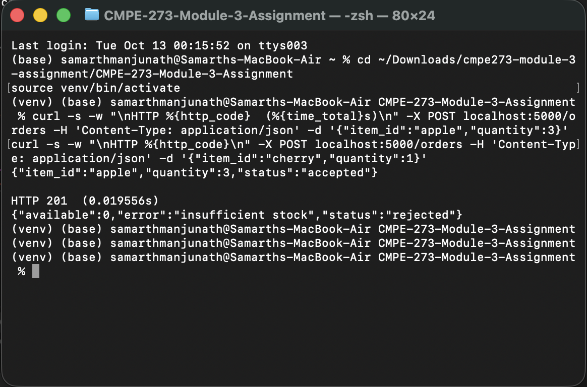
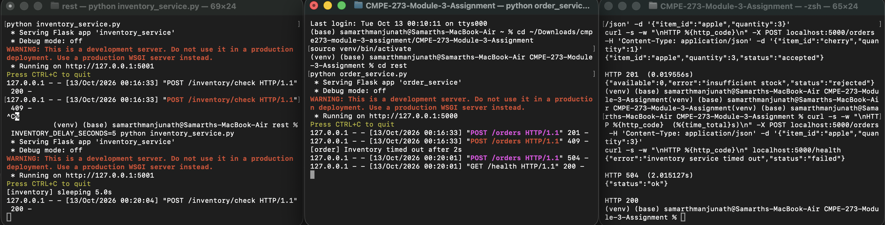
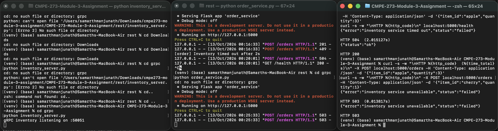
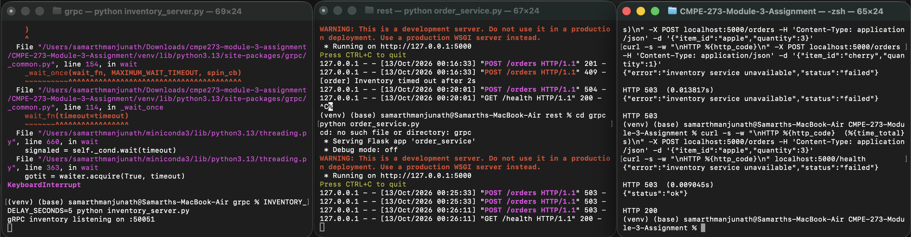

# Module 3: REST & gRPC Service Contracts

Two services implemented twice (Python 3, Flask + `requests` / `grpcio`):

- **Order Service** – accepts `POST /orders` with `{"item_id": ..., "quantity": ...}` on port 5000.
- **Inventory Service** – checks the item exists and has enough stock (stock: `apple`=100, `banana`=5, `cherry`=0).

The Order → Inventory hop is implemented over **REST/JSON** (`rest/`) and **gRPC** (`grpc/`). Both versions use port 5000 for the Order Service, so run only one version at a time.

```
rest/   inventory_service.py (:5001)   order_service.py (:5000, timeout = 2s)
grpc/   inventory.proto  inventory_server.py (:50051)  order_service.py (:5000, deadline = 2s)
evidence/  raw terminal output of the runs below
```

## Setup
```bash
pip install -r requirements.txt
cd grpc && python -m grpc_tools.protoc -I. --python_out=. --grpc_python_out=. inventory.proto   # generates *_pb2.py (gRPC only)
```

## Run the REST version
```bash
cd rest
python inventory_service.py     # terminal 1
python order_service.py         # terminal 2
curl -X POST localhost:5000/orders -H 'Content-Type: application/json' -d '{"item_id":"apple","quantity":3}'
```
Inventory endpoint: `POST /inventory/check` → `200` in stock, `400` bad input, `404` unknown item, `409` insufficient stock.
Order Service timeout: `requests.post(..., timeout=2)`.

## Run the gRPC version
```bash
cd grpc
python inventory_server.py      # terminal 1
python order_service.py         # terminal 2
curl -X POST localhost:5000/orders -H 'Content-Type: application/json' -d '{"item_id":"apple","quantity":3}'
```
Contract: `inventory.proto` defines `rpc CheckInventory(CheckRequest) returns (CheckResponse)`.
Status mapping: unknown item → `NOT_FOUND`, insufficient stock → `FAILED_PRECONDITION`, bad input → `INVALID_ARGUMENT`.
Order Service deadline: `stub.CheckInventory(req, timeout=2)`.

## Successful REST example
```
$ curl -X POST localhost:5000/orders -d '{"item_id":"apple","quantity":3}'
{"item_id":"apple","quantity":3,"status":"accepted"}
HTTP 201  (0.0065s)
```


*Screenshot: successful REST request (HTTP 201) and unavailable item (insufficient stock).*
Unavailable item (cherry, qty 1): `{"available":0,"error":"insufficient stock","status":"rejected"}` → `HTTP 409`

## Successful gRPC example
```
Request  : CheckRequest{item_id:"apple", quantity:3}
Response : CheckResponse{item_id:"apple", requested:3, available:100, in_stock:true}   (gRPC OK)

$ curl -X POST localhost:5000/orders -d '{"item_id":"apple","quantity":3}'
{"available":100,"item_id":"apple","quantity":3,"status":"accepted"}
HTTP 201  (0.013s)
```

Unavailable item (cherry, qty 1): inventory returns `FAILED_PRECONDITION` (`insufficient stock: requested 1, available 0`) → Order returns `HTTP 409`. Unknown item → `NOT_FOUND` → `HTTP 404`.

## Failure handling: slow Inventory Service
Inventory is started with `INVENTORY_DELAY_SECONDS=5` (longer than the 2s timeout/deadline):
```bash
INVENTORY_DELAY_SECONDS=5 python inventory_service.py     # REST (rest/)
INVENTORY_DELAY_SECONDS=5 python inventory_server.py      # gRPC (grpc/)
```

### REST timeout evidence
```
$ curl -X POST localhost:5000/orders -d '{"item_id":"apple","quantity":3}'
{"error":"inventory service timed out","status":"failed"}
HTTP 504  (2.0045s)
--- order service log ---
[order] Inventory timed out after 2s
```


*Screenshot (left to right): Inventory Service sleeping 5s, Order Service logging `Inventory timed out after 2s`, client receiving HTTP 504 after ~2.0s followed by `/health` returning HTTP 200.*

### gRPC deadline evidence
```
$ curl -X POST localhost:5000/orders -d '{"item_id":"apple","quantity":3}'
{"error":"inventory deadline exceeded","status":"failed"}
HTTP 504  (2.0049s)
--- order service log ---
[order] gRPC error: DEADLINE_EXCEEDED - Deadline Exceeded
```


### Order Service stays running after failures
Immediately after each failure above, the same Order Service process answered a health check:
```
$ curl localhost:5000/health
{"status":"ok"}
HTTP 200
```
Both calls returned after ~2.00s (not the 5s delay), and the failure is caught and turned into a clean `504` instead of crashing the process. Screenshots of the terminal output are in `evidence/*.png`. Full logs: `evidence/rest.txt`, `evidence/grpc.txt`.

## Full terminal output

Captured from a real run (two terminals per version: Inventory + Order, plus a client terminal running `curl`). Files are also saved in `evidence/`.

### REST: client terminal (curl)
```
##### REST: normal run #####
$ curl -X POST localhost:5000/orders -d {"item_id":"apple","quantity":3}
{"item_id":"apple","quantity":3,"status":"accepted"}
HTTP 201  (0.006519s)
$ ... insufficient stock (cherry)
{"available":0,"error":"insufficient stock","status":"rejected"}
HTTP 409  (0.004584s)
$ ... unknown item
{"error":"item 'zzz' not found","status":"rejected"}
HTTP 404  (0.003829s)

##### REST: slow inventory (5s delay > 2s timeout) #####
$ curl ... apple (slow inventory)
{"error":"inventory service timed out","status":"failed"}
HTTP 504  (2.004531s)
$ curl localhost:5000/health  (Order Service still up)
{"status":"ok"}
HTTP 200
--- order service log ---
[order] Inventory timed out after 2s
```

### REST: Order Service terminal
```
* Serving Flask app 'order_service'
 * Debug mode: off
WARNING: This is a development server. Do not use it in a production deployment. Use a production WSGI server instead.
 * Running on http://127.0.0.1:5000
Press CTRL+C to quit
127.0.0.1 - - [13/Oct/2026 06:43:32] "POST /orders HTTP/1.1" 201 -
127.0.0.1 - - [13/Oct/2026 06:43:32] "POST /orders HTTP/1.1" 409 -
127.0.0.1 - - [13/Oct/2026 06:43:32] "POST /orders HTTP/1.1" 404 -
[order] Inventory timed out after 2s
127.0.0.1 - - [13/Oct/2026 06:43:37] "POST /orders HTTP/1.1" 504 -
127.0.0.1 - - [13/Oct/2026 06:43:37] "GET /health HTTP/1.1" 200 -
```

### REST: Inventory Service terminal (normal run)
```
* Serving Flask app 'inventory_service'
 * Debug mode: off
WARNING: This is a development server. Do not use it in a production deployment. Use a production WSGI server instead.
 * Running on http://127.0.0.1:5001
Press CTRL+C to quit
127.0.0.1 - - [13/Oct/2026 06:43:32] "POST /inventory/check HTTP/1.1" 200 -
127.0.0.1 - - [13/Oct/2026 06:43:32] "POST /inventory/check HTTP/1.1" 409 -
127.0.0.1 - - [13/Oct/2026 06:43:32] "POST /inventory/check HTTP/1.1" 404 -
```

### REST: Inventory Service terminal (slow run, `INVENTORY_DELAY_SECONDS=5`)
```
* Serving Flask app 'inventory_service'
 * Debug mode: off
WARNING: This is a development server. Do not use it in a production deployment. Use a production WSGI server instead.
 * Running on http://127.0.0.1:5001
Press CTRL+C to quit
[inventory] sleeping 5.0s
```
The Order Service log shows `[order] Inventory timed out after 2s`, followed by the `504` response and then a successful `GET /health` (`200`), so the process kept running.

### gRPC: client terminal (curl)
```
##### gRPC: normal run #####
$ curl -X POST localhost:5000/orders -d {"item_id":"apple","quantity":3}
{"available":100,"item_id":"apple","quantity":3,"status":"accepted"}
HTTP 201  (0.012986s)
$ ... insufficient stock (cherry) -> FAILED_PRECONDITION
{"error":"insufficient stock: requested 1, available 0","status":"rejected"}
HTTP 409  (0.003123s)
$ ... unknown item -> NOT_FOUND
{"error":"item 'zzz' not found","status":"rejected"}
HTTP 404  (0.002390s)

##### gRPC: slow inventory (5s delay > 2s deadline) #####
$ curl ... apple (slow inventory)
{"error":"inventory deadline exceeded","status":"failed"}
HTTP 504  (2.004853s)
$ curl localhost:5000/health  (Order Service still up)
{"status":"ok"}
HTTP 200
--- order service log ---
[order] gRPC error: FAILED_PRECONDITION - insufficient stock: requested 1, available 0
[order] gRPC error: NOT_FOUND - item 'zzz' not found
[order] gRPC error: DEADLINE_EXCEEDED - Deadline Exceeded
```

### gRPC: Order Service terminal
```
* Serving Flask app 'order_service'
 * Debug mode: off
WARNING: This is a development server. Do not use it in a production deployment. Use a production WSGI server instead.
 * Running on http://127.0.0.1:5000
Press CTRL+C to quit
127.0.0.1 - - [13/Oct/2026 06:43:45] "POST /orders HTTP/1.1" 201 -
[order] gRPC error: FAILED_PRECONDITION - insufficient stock: requested 1, available 0
127.0.0.1 - - [13/Oct/2026 06:43:45] "POST /orders HTTP/1.1" 409 -
[order] gRPC error: NOT_FOUND - item 'zzz' not found
127.0.0.1 - - [13/Oct/2026 06:43:45] "POST /orders HTTP/1.1" 404 -
[order] gRPC error: DEADLINE_EXCEEDED - Deadline Exceeded
127.0.0.1 - - [13/Oct/2026 06:43:50] "POST /orders HTTP/1.1" 504 -
127.0.0.1 - - [13/Oct/2026 06:43:50] "GET /health HTTP/1.1" 200 -
```

### gRPC: Inventory Service terminal (normal run)
```
gRPC inventory listening on :50051
```

### gRPC: Inventory Service terminal (slow run, `INVENTORY_DELAY_SECONDS=5`)
```
gRPC inventory listening on :50051
[inventory] sleeping 5.0s
```
The Order Service log shows `DEADLINE_EXCEEDED`, followed by the `504` response and a successful `GET /health` (`200`).

## Supplementary: Order Service when Inventory is unreachable (REST)

These screenshots are from an extra run, not the gRPC run. The REST Order Service (`rest/order_service.py`) was running while the REST Inventory Service was stopped, so nothing was listening on port 5001 (a gRPC inventory server was started separately on port 50051 and was not called). The Order Service handled the connection failure cleanly by returning `HTTP 503` ("inventory service unavailable") and then kept running and answered `/health` with `HTTP 200`. This is a different failure from the timeout above and shows the same resilience.


*Left to right: gRPC inventory server listening on :50051, REST Order Service, client receiving `HTTP 503` for both requests.*


*The Order Service logs `503` responses, then `GET /health` returns `HTTP 200`, so it stayed up.*

## REST vs. gRPC comparison
With REST, the contract was implicit: I hand-wrote the JSON field names and chose HTTP status codes (200/404/409), and nothing enforced them on either side. With gRPC, the `.proto` file is the single source of truth, and generated stubs gave typed request/response objects and a built-in status vocabulary (`NOT_FOUND`, `FAILED_PRECONDITION`, `DEADLINE_EXCEEDED`). Timeouts were comparable in effort (`timeout=2` vs. a deadline argument), but a gRPC deadline is part of the call itself and can propagate to downstream services, while a REST timeout is only a client-side setting. REST was quicker to start and easier to debug with plain `curl`, whereas gRPC needed a code-generation step and extra tooling to inspect calls. In both cases the Order Service had to explicitly translate the failure into its own response, which is what kept it running.
